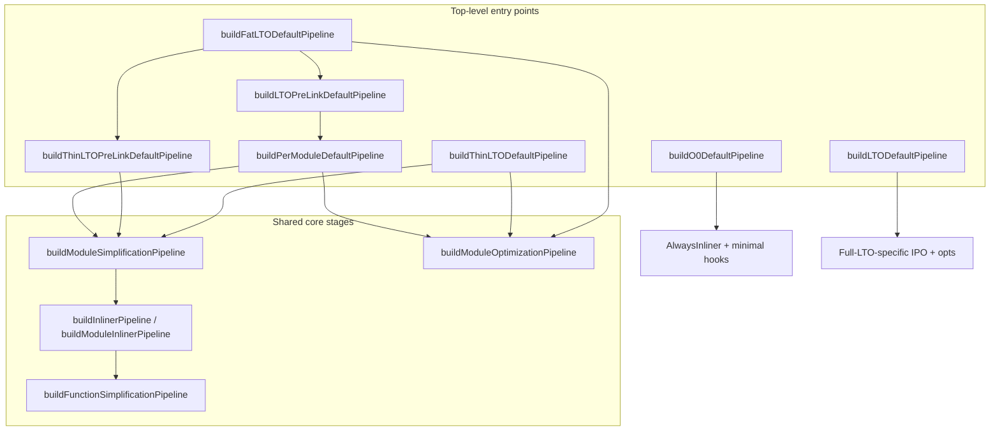

# LLVM `PassBuilder` Pipelines in `PassBuilderPipelines.cpp`

This document explains how LLVM builds optimization pipelines in
`llvm/lib/Passes/PassBuilderPipelines.cpp`, what problem that design solves, and
how the individual `build*Pipeline` entry points differ.

**Primary sources**

| File | Role |
|------|------|
| `llvm/lib/Passes/PassBuilderPipelines.cpp` | Pipeline definitions (implementations) |
| `llvm/include/llvm/Passes/PassBuilder.h` | Public API and intent comments |
| `llvm/include/llvm/Passes/OptimizationLevel.h` | `O0`–`O3` levels |
| `llvm/include/llvm/Pass.h` | `ThinOrFullLTOPhase` enum |

---

## 1. The idea: why build pipelines?

### Problem

LLVM IR passes are small, single-purpose transforms (inlining, DCE, loop
vectorization, …). A real compiler must run **dozens to hundreds** of them in a
**specific order**, with different aggressiveness at `-O1`/`-O2`/`-O3`, and
different behavior for:

- single translation-unit (TU) compile vs link-time optimization (LTO),
- pre-link vs post-link LTO phases,
- debug-friendly vs speed-optimized builds,
- profile-guided optimization (PGO) and sanitizer instrumentation.

Before the **New Pass Manager (NPM)**, pass order was scattered across legacy
pass managers and frontends. That made it hard to:

1. Share one canonical `-O3` recipe across Clang, Flang, JIT, MLIR execution engine, and embedders (e.g. Triton).
2. Insert plugin/extension passes at well-defined points.
3. Vary behavior consistently by optimization level and LTO phase.

### Solution: `PassBuilder` composes layered pipelines

`PassBuilder` is a **factory** that assembles `ModulePassManager` /
`FunctionPassManager` objects from reusable **sub-pipelines**. Think of it as a
structured recipe book, not a flat list of passes.

Core design principles (from LLVM comments and structure):

| Principle | Meaning |
|-----------|---------|
| **Layering** | Low-level builders (`buildFunctionSimplificationPipeline`) are nested inside higher-level ones (`buildModuleSimplificationPipeline` → `buildPerModuleDefaultPipeline`). |
| **Simplification vs optimization** | Simplification canonicalizes IR and is mostly safe to repeat; optimization (vectorization, aggressive unrolling) is cost-model driven and can hurt if rerun blindly. |
| **LTO phase parameter** | `ThinOrFullLTOPhase` tunes the same builder for pre-link (conservative, preserve cross-module info) vs post-link (aggressive IPO, imports, devirtualization). |
| **Extension points (EP callbacks)** | Frontends register hooks (`PipelineStartEP`, `PeepholeEP`, `VectorizerStartEP`, …) without forking the whole pipeline. |
| **Optimization level** | `OptimizationLevel::O0`–`O3` selects different pass sets and thresholds inside the same builders. |

### Mental model

```
Frontend / embedder
    └─ PassBuilder
         ├─ Top-level pipeline (per-module, LTO, fat LTO, O0, …)
         │    ├─ buildModuleSimplificationPipeline   ← canonicalize + inline + global opts
         │    └─ buildModuleOptimizationPipeline     ← loops, vectorize, late IPO
         └─ Nested sub-pipelines
              ├─ buildInlinerPipeline / buildModuleInlinerPipeline
              └─ buildFunctionSimplificationPipeline (+ O1 variant)
```

**Typical end-to-end flow for a normal optimized TU** (`clang -O3` without LTO):

```
buildPerModuleDefaultPipeline(O3)
  → early module setup (annotations, attrs, PGO hooks)
  → buildModuleSimplificationPipeline(O3, None)
       → early cleanup, IPSCCP, globalopt, inliner wrapper, DAE, …
  → buildModuleOptimizationPipeline(O3, None)
       → loop opts, vectorization, late module transforms
  → remark passes, optional LTO pre-link extras
```

---

## 2. LTO phase axis (`ThinOrFullLTOPhase`)

Many builders take a `ThinOrFullLTOPhase` argument. This is orthogonal to
`OptimizationLevel`.

| Phase | When | Typical goal |
|-------|------|--------------|
| `None` | Normal single-TU compile | Full per-module optimization |
| `ThinLTOPreLink` | `clang -flto=thin -c` | Emit summary bitcode; simplify but avoid irreversible opts that hurt the ThinLTO backend |
| `ThinLTOPostLink` | ThinLTO backend (`llvm-lto` / linker plugin) | Import functions, WPD/CFI, then full simplification + optimization |
| `FullLTOPreLink` | `clang -flto -c` | Similar to normal `-O` but tagged for later full LTO merge |
| `FullLTOPostLink` | Monolithic LTO link | Whole-program visibility; aggressive IPO and devirtualization |

Pre-link pipelines **defer** vectorization, heavy unrolling, and some inlining
decisions so the link step sees a smaller, still-flexible IR. Post-link pipelines
**exploit whole-program knowledge** (imported symbols, summary index, devirt).

---

## 3. Pipeline entry points: differences and typical use

### Overview table

| Builder | Returns | Scope | Typical caller / command |
|---------|---------|-------|--------------------------|
| `buildO1FunctionSimplificationPipeline` | `FunctionPassManager` | Single function; O1-only recipe | Internal; called from `buildFunctionSimplificationPipeline` |
| `buildFunctionSimplificationPipeline` | `FunctionPassManager` | Single function; O1/O2/O3 | Nested inside inliner CGSCC walk |
| `buildInlinerPipeline` | `ModuleInlinerWrapperPass` | Module (CGSCC-based inliner) | Default inliner path in simplification pipeline |
| `buildModuleInlinerPipeline` | `ModulePassManager` | Module (new module inliner) | When `EnableModuleInliner` is on |
| `buildModuleSimplificationPipeline` | `ModulePassManager` | Whole module | Pre-optimization canonicalization + inlining |
| `buildModuleOptimizationPipeline` | `ModulePassManager` | Whole module | Speed/code-size optimization after simplification |
| `buildPerModuleDefaultPipeline` | `ModulePassManager` | Whole module | **`clang -O[123]`**, Triton `llvm.optimize_module`, MLIR JIT |
| `buildO0DefaultPipeline` | `ModulePassManager` | Whole module | **`clang -O0`**, minimal required transforms |
| `buildThinLTOPreLinkDefaultPipeline` | `ModulePassManager` | Pre-link ThinLTO TU | **`clang -flto=thin -c -O2`** |
| `buildThinLTODefaultPipeline` | `ModulePassManager` | ThinLTO backend | `LTOBackend.cpp`, `ThinLTOCodeGenerator.cpp` |
| `buildLTOPreLinkDefaultPipeline` | `ModulePassManager` | Pre-link full LTO TU | **`clang -flto -c`** (currently aliases per-module pipeline) |
| `buildLTODefaultPipeline` | `ModulePassManager` | Full LTO post-link | `LTOBackend.cpp` during monolithic LTO |
| `buildFatLTODefaultPipeline` | `ModulePassManager` | Fat object (code + embedded bitcode) | **`clang -ffat-lto-objects`** |
| `buildDefaultAAPipeline` | `AAManager` | Alias analysis stack | Registered into NPM analyses for all pipelines |

---

### 3.1 `buildO1FunctionSimplificationPipeline`

**What it does:** Function-local simplification tuned for **`-O1`**: SROA, EarlyCSE,
InstCombine, loop rotate/LICM/unswitch/idiom recognition, limited unrolling, SCCP,
ADCE. Lighter and more debug-friendly than O2/O3.

**Problem it solves:** O1 needs a **distinct, readable** recipe; folding it into
the O2/O3 function pipeline would make the file harder to maintain.

**Typical use:** Not called directly by frontends. Invoked only when
`Level == OptimizationLevel::O1` inside `buildFunctionSimplificationPipeline`.

**Example:** `clang -O1 -c foo.c` eventually runs this inside the inliner’s
per-function simplification step.

---

### 3.2 `buildFunctionSimplificationPipeline`

**What it does:** Core **per-function canonicalization** for O2/O3 (O1 delegates
to the O1 builder). Includes SROA, GVN hoist/sink, jump threading, aggressive
InstCombine, loop simplification/unroll, MemCpyOpt, coroutine elision, etc.

**Problem it solves:** Inlining repeatedly exposes new local optimization
opportunities. This pipeline is the **“cleanup after inline”** workhorse at
function granularity.

**Typical use:** Nested in `buildInlinerPipeline` / `buildModuleInlinerPipeline`
via `createCGSCCToFunctionPassAdaptor(buildFunctionSimplificationPipeline(...))`.

**Example:** After the inliner pulls `helper()` into `main()`, this pipeline
runs InstCombine/SROA on the enlarged `main()` body.

**Note (LLVM comment):** Intended for optimization levels ≠ O0; not for semantic
lowering required regardless of `-O`.

---

### 3.3 `buildInlinerPipeline`

**What it does:** Returns a **`ModuleInlinerWrapperPass`** that walks the
**call graph (CGSCC order)**, runs the inliner, and after each inline runs
`buildFunctionSimplificationPipeline`. Includes argument promotion (O3), OpenMP
CGSCC opts, coroutine splitting (non-pre-link).

**Problem it solves:** Inlining is inherently **interprocedural** and must be
interleaved with function simplification. CGSCC order ensures callers are
optimized after callees are simplified.

**Typical use:** Default path in `buildModuleSimplificationPipeline` when
`EnableModuleInliner` is false (still the common case in many builds).

**Example:** Devirtualized or profile-hot calls get inlined, then immediately
cleaned up before the next CGSCC node is processed.

---

### 3.4 `buildModuleInlinerPipeline`

**What it does:** Alternative **module-level inliner** implementation
(`ModuleInlinerPass`) with its own pass manager structure, same general goal as
`buildInlinerPipeline`.

**Problem it solves:** LLVM is migrating/experimenting with a module inliner that
can differ in heuristics and scheduling from the legacy CGSCC wrapper.

**Typical use:** Selected when `EnableModuleInliner` is true inside
`buildModuleSimplificationPipeline`. Also used in ThinLTO post-link for
contextual profile (`UseCtxProfile`) paths.

**Example:** Same as inliner pipeline, but inliner decisions are driven by the
new module inliner pass rather than `ModuleInlinerWrapperPass`.

---

### 3.5 `buildModuleSimplificationPipeline`

**What it does:** **Module-wide simplification** before heavy optimization:

- Frontend cleanup (InferFunctionAttrs, CoroEarly, EarlyCSE, SimplifyCFG)
- Sample/PGO loading and indirect call promotion (phase-dependent)
- IPSCCP, CalledValuePropagation, GlobalOpt
- AlwaysInliner + **inliner pipeline** (module or CGSCC)
- DeadArgumentElimination, GlobalOpt/GlobalDCE

**Problem it solves:** Prepares the whole module so later optimization sees
** smaller, canonical IR with accurate attrs and globals folded**—without yet
doing aggressive loop vectorization or code growth.

**Typical use:** First major stage inside `buildPerModuleDefaultPipeline`,
`buildThinLTODefaultPipeline`, and (partially) LTO post-link flows.

**Example:** `clang -O2 -c` runs this before loop vectorization. In
`ThinLTOPreLink`, it **skips** heavy unrolling/vectorization to keep backend IR
stable for profile annotation.

**Key constraint:** Asserts `Level != O0` and not `FullLTOPostLink`.

---

### 3.6 `buildModuleOptimizationPipeline`

**What it does:** The **second half** of `-O1`/`-O2`/`-O3` after
`buildModuleSimplificationPipeline`. Where simplification **canonicalizes** IR,
this stage **optimizes for speed** (accepting more code growth). It is **skipped**
in ThinLTO **pre-link**; for Triton (`Phase = None`) it runs fully after
simplification.

**Problem it solves:** Separates **code-growth / IR-destructive** opts from
simplification so LTO pre-link can defer vectorization, heavy unrolling, and
similar transforms until post-link.

**Typical use:** Second major stage in `buildPerModuleDefaultPipeline` and LTO
post-link pipelines.

**Example:** `clang -O3 -c` enables loop vectorization and SLP here. Triton’s
`llvm.optimize_module(..., OPTIMIZE_O3)` runs this after simplification on GPU
kernel LLVM IR.

**Note (LLVM comment):** Not safe to run repeatedly; may regress performance or
inflate code size if re-run naively.

#### Pipeline flow (high level)

```
Module-level setup
  PartialInliner, EliminateAvailableExternally, RPO attrs, PGO, GlobalsAA
  invokeOptimizerEarlyEPCallbacks          ← GPU hooks (AMDGPU only, if TM set)

Function-level OptimizePM
  DropAssumes, LoopVersioningLICM, Float2Int, ...
  invokeVectorizerStartEPCallbacks         ← Triton + optional targets
  LoopRotate → LoopDeletion → LoopInterchange
  LoopDistribute
  addVectorPasses                          ← LoopVectorize, SLP, Unroll, SROA, LICM
  invokeVectorizerEndEPCallbacks           ← AMDGPU InferAddressSpaces
  LoopSink, DivRemPairs, SimplifyCFG, ...

Module-level cleanup
  AllocToken, invokeOptimizerLastEPCallbacks  ← AMDGPU Attributor
  HotColdSplit, GlobalDCE, MergeFunctions, devirt + re-inline (optional)
```

Source: `PassBuilderPipelines.cpp` lines ~1510–1751.

#### Main pass groups (target-neutral)

| Block | Passes | Effect |
|-------|--------|--------|
| **Module prep** | `PartialInlinerPass`, `EliminateAvailableExternallyPass`, `ReversePostOrderFunctionAttrsPass`, `RecomputeGlobalsAAPass` | IPO cleanup; alias info for vectorizer |
| **Loop structure** | `LoopRotatePass`, `LoopDeletionPass`, `LoopInterchangePass`, `LoopDistributePass`, `LoopFusePass` | Reshape loops for vectorization / ILP |
| **`addVectorPasses`** | **`LoopVectorizePass`**, **`SLPVectorizerPass`**, `VectorCombinePass`, **`LoopUnrollPass`**, `LoopLoadEliminationPass`, `SROAPass`, `LICMPass`, `InstCombinePass` | Main performance wins — SIMD + unrolling |
| **Late function cleanup** | `LoopSinkPass`, `DivRemPairsPass`, `SimplifyCFGPass`, `TailCallElimPass` | CFG cleanup after vectorization |
| **Module tail** | `GlobalDCEPass`, `ConstantMergePass`, `MergeFunctionsPass`, optional `WholeProgramDevirtPass` + second inliner | Whole-module cleanup |

For **GPU kernels**, the most impactful generic passes are usually:

- **`LoopVectorizePass`** — widen loop iterations
- **`SLPVectorizerPass`** — pack independent scalar ops into vectors (Triton disables on sm_80 — ptxas issue)
- **`LoopUnrollPass`** — expose ILP; can help memory access patterns
- **`LICMPass`** — hoist invariants out of loops
- **`InstCombinePass`** / **`SimplifyCFGPass`** — constant fold, remove dead branches

#### `addVectorPasses` — core of this builder (~lines 1343–1506)

Called from line 1641 inside `buildModuleOptimizationPipeline`. Typical order:

```
LoopVectorizePass          ← loop-level SIMD
InstCombine + InferAlignmentPass
SLPVectorizerPass          ← basic-block SIMD (optional; Triton off on sm_80)
VectorCombinePass
LoopUnrollPass             ← unroll after vectorize
SROA (late, preserve CFG)
LICMPass (cleanup)
```

This is where **`clang -O3`** and **`llvm.optimize_module(O3)`** spend most of
their optimization budget.

#### GPU-related parts

**Hard-coded in this function:** none for NVPTX/CUDA. No NVPTX-specific passes are
listed directly in `buildModuleOptimizationPipeline`.

**Extension points** (where GPU targets plug in):

| EP callback | Line | NVPTX | AMDGPU | Triton |
|-------------|------|-------|--------|--------|
| `invokeOptimizerEarlyEPCallbacks` | ~1561 | — | — | — |
| `invokeVectorizerStartEPCallbacks` | ~1606 | — | — | **`BreakStructPhiNodesPass`** + InstCombine |
| `invokeVectorizerEndEPCallbacks` | ~1643 | — | **`InferAddressSpacesPass`** | — |
| `invokeOptimizerLastEPCallbacks` | ~1687 | — | **`AMDGPUAttributorPass`** | — |

- **NVPTX** registers nothing in these optimization EPs — only `PipelineStartEP`
  (`NVVMReflectPass`, `NVVMIntrRangePass`; see NVPTX target docs) and **codegen**
  passes in `NVPTXCodeGenPassBuilder::addIRPasses`.
- **AMDGPU** adds **`InferAddressSpacesPass`** after vectorization (rewrite pointer
  address spaces: global/shared/local) and **`AMDGPUAttributorPass`** at the end
  of optimization (GPU-specific attribute inference). Requires an AMDGPU
  `TargetMachine` on `PassBuilder`.
- **Triton** registers at **`VectorizerStartEP`** in `triton/python/src/llvm.cc`:

  ```cpp
  pb.registerVectorizerStartEPCallback(...) {
    fpm.addPass(BreakStructPhiNodesPass());  // struct phis → scalars
    fpm.addPass(InstCombinePass());
  });
  ```

  And from `triton/third_party/nvidia/backend/compiler.py`:

  ```python
  llvm.optimize_module(..., disable_slp_vectorizer=capability == 80)
  ```

  → sets `tuningOptions.SLPVectorization = false` → **`SLPVectorizerPass` skipped**
  in `addVectorPasses` when `PTO.SLPVectorization` is false.

  After the full pipeline, Triton may run **`ExpandMaskedDivRemPass`** (NVIDIA-specific,
  outside this builder, in `llvm.cc` after `buildPerModuleDefaultPipeline`).

#### vs `buildModuleSimplificationPipeline`

| | Simplification | Optimization (this builder) |
|---|----------------|----------------------------|
| **Goal** | Canonicalize, inline, fold globals | Speed: loops, vectors, unroll |
| **Safe to repeat?** | Mostly yes | No — can bloat IR |
| **ThinLTO pre-link** | Runs | **Skipped** |
| **GPU EP hooks** | Early simplification, peephole, inliner CGSCC | Vectorizer start/end, optimizer last |
| **Triton** | Generic inliner/SROA/InstCombine | Generic + BreakStructPhiNodes; SLP off on sm_80 |

---

### 3.7 `buildPerModuleDefaultPipeline` ⭐ (most common top-level)

**What it does:** The **standard `-O[123]` per-TU pipeline** without LTO:

```
if O0 → buildO0DefaultPipeline
else:
  setup (Annotation2Metadata, ForceFunctionAttrs, PGO start hooks)
  buildModuleSimplificationPipeline(Level, Phase)
  buildModuleOptimizationPipeline(Level, Phase)
  optional LTO pre-link required passes if Phase is pre-link
```

**Problem it solves:** One **blessed default** for “optimize this module now”
shared across Clang, Flang, MLIR execution engine, OpenMP offload JIT, and
embedders.

**Typical use:**

| Scenario | Invocation |
|----------|------------|
| Normal compile | `clang -O3 -c file.c` → `BackendUtil.cpp` |
| No LTO | `PassBuilder::buildPerModuleDefaultPipeline(Level)` |
| Triton GPU | `llvm.optimize_module(mod, llvm.OPTIMIZE_O3)` in `triton/python/src/llvm.cc` |
| MLIR JIT | `OptUtils.cpp` |
| OpenMP JIT | `offload/.../JIT.cpp` |

**Example:** Compiling a single `.cpp` to `.o` with `-O3` and no `-flto` uses
exactly this pipeline end-to-end.

---

### 3.8 `buildO0DefaultPipeline`

**What it does:** **Minimal semantics-preserving pipeline** for `-O0`:

- Entry/exit instrumentation, optional PGO instrumentation
- `AlwaysInlinerPass` (required for correctness of some IR)
- Optional MergeFunctions, matrix lowering, coroutine/cleanup hooks
- **No** full simplification/optimization pipelines

**Problem it solves:** Fast compile and debuggable IR while still honoring LLVM
requirements (always-inline, coroutines, sanitizers, PGO instrumentation).

**Typical use:** `clang -O0`, and as the O0 branch of pre-link LTO builders.

**Example:** `-O0 -g` build still runs always-inline but skips vectorization and
most InstCombine loops.

---

### 3.9 `buildThinLTOPreLinkDefaultPipeline`

**What it does:** ThinLTO **compile-time (pre-link)** pipeline:

- Same early setup as per-module
- **`buildModuleSimplificationPipeline(ThinLTOPreLink)` only** — intentionally
  **no** `buildModuleOptimizationPipeline`
- Optional partial inlining, pseudo-probe update, pre-link EP callbacks
- `addRequiredLTOPreLinkPasses` (summary emission prep)

**Problem it solves:** Emit **summary bitcode** and simplified IR without
bloating objects or making irreversible opts that the ThinLTO backend would regret.

**Typical use:** `clang -flto=thin -O2 -c foo.c` → `BackendUtil.cpp` when
`PrepareForThinLTO` is set.

**Example:** Each `.o` contains optimized-ish IR + summary; the linker runs
thin link; then each partition is optimized with `buildThinLTODefaultPipeline`.

---

### 3.10 `buildThinLTODefaultPipeline`

**What it does:** ThinLTO **backend (post-link)** pipeline for one imported module:

- MemProf cleanup, WPD + LowerTypeTests (if summary present)
- O0: coroutine wrapper, AllocToken, GlobalDCE
- O1+: simplification (or module inliner for ctx profile) + **full optimization**
- Annotation remarks

**Problem it solves:** Apply **cross-module imported IR** and whole-program
devirtualization, then run the same heavy opts as a normal `-O3` compile on the
merged view of each partition.

**Typical use:**

- `llvm/lib/LTO/LTOBackend.cpp` (linker plugin backend)
- `llvm/lib/LTO/ThinLTOCodeGenerator.cpp`
- Part of `buildFatLTODefaultPipeline` for sample-PGO fat LTO

**Example:** Linking 100 TUs with `-flto=thin`; backend compiles each thin
partition with imported bodies from other TUs before codegen.

---

### 3.11 `buildLTOPreLinkDefaultPipeline`

**What it does:** Currently **delegates to** `buildPerModuleDefaultPipeline(Level,
FullLTOPreLink)` (with a FIXME to customize).

**Problem it solves:** Placeholder for full (non-thin) LTO pre-link behavior; today
runs nearly the same opts as normal compile but tags phase for later LTO.

**Typical use:** `clang -flto -c` (classic full LTO) when `PrepareForLTO`.

**Example:** Produce bitcode objects that will be **merged into one module** at
link time rather than thin partitions.

---

### 3.12 `buildLTODefaultPipeline`

**What it does:** **Monolithic full LTO post-link** pipeline on the **linked
module**:

- Cross-DSO CFI, WPD, LowerTypeTests
- Sample profile reload at LTO time
- OpenMP opt, GlobalDCE, IPSCCP, inlining promotions
- Custom LTO loop/inliner sequence (distinct ordering from thin backend in places)
- Coroutine wrapper, annotation remarks

**Problem it solves:** Optimize the **entire program at once** when all IR is
available in a single merged module (maximum IPO visibility).

**Typical use:** `LTOBackend.cpp` when not using ThinLTO.

**Example:** `clang -flto` link of a whole program; `llvm-lto` runs this on the
combined bitcode before codegen.

---

### 3.13 `buildFatLTODefaultPipeline`

**What it does:** **Fat LTO object** pipeline — one compile produces **native
object code AND embedded bitcode**:

1. Run Thin or Full **pre-link** pipeline
2. `EmbedBitcodePass` (embed IR in `.o`)
3. `FatLtoCleanup`, `DropTypeTestsPass`
4. Then either `buildThinLTODefaultPipeline` (sample PGO thin) or coroutine passes +
   `buildModuleOptimizationPipeline` for codegen path

**Problem it solves:** Ship **cacheable native objects** for normal links while
retaining bitcode for **later LTO** without recompiling from source (used in
distributed/Facebook-style build systems).

**Typical use:** `clang -ffat-lto-objects` → `BackendUtil.cpp` / Flang frontend.

**Example:** CI builds fat `.o` files; release link later extracts bitcode and
runs ThinLTO backend without rebuilding from C++ source.

---

### 3.14 `buildDefaultAAPipeline`

**What it does:** Builds the **alias analysis (AA) stack** (BasicAA, ScopedNoAlias,
TypeBasedAA, GlobalsAA, target-specific AA).

**Problem it solves:** Many passes depend on consistent AA; central registration
keeps analyses ordered and target-aware.

**Typical use:** Not a transformation pipeline; registered with NPM when constructing
`PassBuilder`. Used indirectly by every pipeline above.

**Example:** Loop vectorization queries AA to prove two pointers don’t alias before
widening loads.

---

## 4. How Clang chooses a top-level pipeline

From `clang/lib/CodeGen/BackendUtil.cpp`:

```cpp
if (CodeGenOpts.FatLTO) {
  MPM.addPass(PB.buildFatLTODefaultPipeline(...));
} else if (PrepareForThinLTO) {
  MPM.addPass(PB.buildThinLTOPreLinkDefaultPipeline(Level));
} else if (PrepareForLTO) {
  MPM.addPass(PB.buildLTOPreLinkDefaultPipeline(Level));
} else {
  MPM.addPass(PB.buildPerModuleDefaultPipeline(Level));
}
```

Post-link LTO does **not** go through Clang; the linker invokes `LTOBackend.cpp`,
which calls `buildThinLTODefaultPipeline` or `buildLTODefaultPipeline`.

---

## 5. Composition diagram



---

## 6. Practical examples (quick reference)

| User command / API | Pipeline used |
|--------------------|---------------|
| `clang -O0 -c a.c` | `buildO0DefaultPipeline` |
| `clang -O3 -c a.c` | `buildPerModuleDefaultPipeline(O3)` |
| `clang -flto=thin -O2 -c a.c` | `buildThinLTOPreLinkDefaultPipeline(O2)` |
| `clang -flto=thin` (link) | `buildThinLTODefaultPipeline` per partition |
| `clang -flto -O3 -c a.c` | `buildLTOPreLinkDefaultPipeline(O3)` |
| `clang -flto` (link, monolithic) | `buildLTODefaultPipeline` |
| `clang -ffat-lto-objects -O3 -c a.c` | `buildFatLTODefaultPipeline` |
| Triton `llvm.optimize_module(m, OPTIMIZE_O3)` | `buildPerModuleDefaultPipeline(O3)` |
| MLIR `ExecutionEngine` opt | `buildPerModuleDefaultPipeline` |

---

## 7. Simplification vs optimization (design split)

| Aspect | `buildModuleSimplificationPipeline` | `buildModuleOptimizationPipeline` |
|--------|-------------------------------------|-------------------------------------|
| Primary goal | Canonicalize, inline, fold globals | Maximize runtime performance |
| Idempotency | Mostly safe to conceptually repeat | Can hurt if repeated |
| Inlining | Central stage | Partial inlining only (optional) |
| Vectorization | Generally deferred | Loop/SLP vectorization here |
| LTO pre-link | Runs (conservatively) | **Skipped** in ThinLTO pre-link |
| Typical IR effect | Fewer instructions, simpler CFG | Wider vectors, unrolled loops, more code |

---

## 8. Extension points (why embedders use `PassBuilder`)

Frontends and runtimes register callbacks on `PassBuilder` to inject passes without
copying entire pipelines:

| Callback | Approximate insertion |
|----------|---------------------|
| `PipelineStartEP` | Start of module pipeline |
| `PipelineEarlySimplificationEP` | Early in simplification |
| `PeepholeEP` | Around InstCombine peephole slots |
| `CGSCCOptimizerLateEP` | Inside inliner CGSCC walk |
| `VectorizerStartEP` / `VectorizerEndEP` | Around vectorizers |
| `OptimizerEarlyEP` / `OptimizerLastEP` | Module optimization stage |

Clang registers sanitizer, coverage, and profiling passes this way in
`BackendUtil.cpp`.

---

## 9. Relation to Triton (external embedder)

Triton does **not** use Clang’s driver. After MLIR → LLVM IR lowering it calls:

```python
llvm.optimize_module(llvm_mod, llvm.OPTIMIZE_O3, ...)
```

which maps to `PassBuilder::buildPerModuleDefaultPipeline(O3)` in
`triton/python/src/llvm.cc` — the same mid-level O3 recipe as `clang -O3 -c`,
plus Triton-specific extra passes (e.g. `BreakStructPhiNodesPass`,
optional `ExpandMaskedDivRemPass`).

---

## 10. Summary

- **Building pipelines** solves the problem of **maintaining a consistent, level-
  and phase-aware pass order** across many LLVM clients.
- **Sub-builders** (`FunctionSimplification`, `Inliner`, `ModuleSimplification`,
  `ModuleOptimization`) are **composable layers**, not alternative compilers.
- **Top-level builders** select **which layers run** and **how LTO phase
  modifies them**.
- For day-to-day development, **`buildPerModuleDefaultPipeline`** is the default
  mental model for `-O1`/`-O2`/`-O3`; LTO and fat-LTO builders are variations
  that split work across compile, link, and backend phases.
